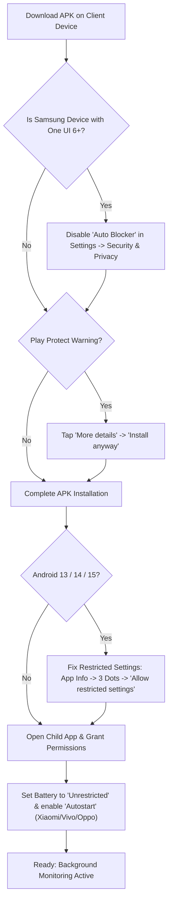

# Seftly — Build, Release & Delivery Pipeline Reference

> **Document Purpose:** Complete, step-by-step authoritative reference for compiling, signing, testing, and delivering production-ready Universal release APKs for both **Parent App** (`parent-app`) and **Child App** (`child-app`), along with customer onboarding and device-specific OS troubleshooting.

---

## 1. Release Build Architecture Overview

```
parental-monitoring-mvp/
├── parent-app/              # Flutter 3.x (Parent supervisory client)
│   ├── android/
│   │   ├── app/build.gradle.kts       # compileSdk = 34, targetSdk = 34, Release Signing
│   │   └── parentapp-release-key.jks  # Production release keystore
│   └── build/app/outputs/flutter-apk/app-release.apk
│
├── child-app/               # Native Kotlin + Jetpack Compose (Child background daemon)
│   ├── app/build.gradle.kts           # compileSdk = 34, targetSdk = 34, Release Signing
│   ├── childapp-release-key.jks       # Production release keystore
│   └── app/build/outputs/apk/release/app-release.apk
│
└── release_apks/            # Distribution directory containing the latest standalone APKs
    ├── parent-app-release.apk
    └── child-app-release.apk
```

---

## 2. Signing & Keystore Configurations

Both applications must use dedicated, persistent RSA-2048 release keystores (never the ephemeral `debug.keystore`) to prevent `INSTALL_FAILED_UPDATE_INCOMPATIBLE` signature collisions upon customer updates.

### 2.1. Keystore Details

| Parameter | Child App (`child-app`) | Parent App (`parent-app`) |
| :--- | :--- | :--- |
| **Keystore File** | `child-app/childapp-release-key.jks` | `parent-app/android/parentapp-release-key.jks` |
| **Key Alias** | `childapp` | `parentapp` |
| **Store Password** | `123457` | `123457` |
| **Key Password** | `123457` | `123457` |
| **Algorithm** | RSA 2048-bit, 10,000 days validity | RSA 2048-bit, 10,000 days validity |

---

## 3. Build Commands & Compilation

> [!IMPORTANT]
> **Always generate Universal (Fat) APKs.** Never use `--split-per-abi` for ad-hoc client delivery. Split APKs fail to install on 32-bit (`armeabi-v7a`), x86, or emulator devices with `INSTALL_FAILED_NO_MATCHING_ABIS`.

### 3.1. Parent App (Flutter)
Compile the Flutter project into a universal release APK:

```bash
cd /mnt/503ADFEC3ADFCD5A/code/flutter/parental-monitoring-mvp/parent-app
flutter clean
flutter pub get
flutter build apk --release --no-tree-shake-icons
```

* **Output location:** `parent-app/build/app/outputs/flutter-apk/app-release.apk`

---

### 3.2. Child App (Native Android Kotlin)
Compile the native Kotlin Gradle project into a universal release APK:

```bash
cd /mnt/503ADFEC3ADFCD5A/code/flutter/parental-monitoring-mvp/child-app
./gradlew clean
./gradlew assembleRelease
```

* **Output location:** `child-app/app/build/outputs/apk/release/app-release.apk`

---

## 4. Distribution Artifacts Sync Script

To package and update the standalone APKs in the root `release_apks/` directory:

```bash
# 1. Clean previous release APKs
rm -f /mnt/503ADFEC3ADFCD5A/code/flutter/parental-monitoring-mvp/release_apks/*.apk

# 2. Copy latest parent-app release
cp /mnt/503ADFEC3ADFCD5A/code/flutter/parental-monitoring-mvp/parent-app/build/app/outputs/flutter-apk/app-release.apk \
   /mnt/503ADFEC3ADFCD5A/code/flutter/parental-monitoring-mvp/release_apks/parent-app-release.apk

# 3. Copy latest child-app release
cp /mnt/503ADFEC3ADFCD5A/code/flutter/parental-monitoring-mvp/child-app/app/build/outputs/apk/release/app-release.apk \
   /mnt/503ADFEC3ADFCD5A/code/flutter/parental-monitoring-mvp/release_apks/child-app-release.apk
```

---

## 5. Client Installation & Setup Guide (গ্রাহকদের জন্য ইনস্টলেশন নির্দেশিকা)

Due to advanced parental control capabilities (Accessibility Service, Screen Projection, Foreground Camera/Mic), standard Android security features may restrict sideloaded APKs. Provide clients with these instructions:



### 5.1. Bypassing Installation Blocks

1. **Samsung One UI 6+ (Auto Blocker):**
   * Go to **Settings** $\rightarrow$ **Security and privacy** $\rightarrow$ **Auto Blocker**.
   * Turn the toggle **OFF** temporarily during installation.
2. **Google Play Protect:**
   * When prompted with *"Blocked by Play Protect - Unsafe app"*, tap **More details** $\rightarrow$ **Install anyway**.

---

### 5.2. Post-Installation Permissions Setup (Android 13 & 14+)

1. **Unlocking Accessibility ("Restricted Setting"):**
   * Open phone **Settings** $\rightarrow$ **Apps** $\rightarrow$ **Child Monitoring** (`com.example.childapp`).
   * Tap the **3-dot menu** in the top-right corner.
   * Select **"Allow restricted settings"** and confirm with device PIN/Fingerprint.
   * Return to the app and toggle **Accessibility Service** ON.
2. **Battery & Background Auto-start (Xiaomi, Samsung, Oppo, Vivo):**
   * **Battery:** In App Info $\rightarrow$ **Battery** $\rightarrow$ select **"Unrestricted"** / **"No restrictions"**.
   * **Autostart:** In Xiaomi (MIUI/HyperOS) / Vivo / Oppo, enable **Autostart / Background launch** permission.
   * **Recents Lock:** Lock the app in the recent apps overview screen to prevent aggressive RAM cleanup.
3. **Device Language Recommendation:**
   * For automated stealth screen capture consent handling, keep the child device system language in **English** (or ensure accessibility overlay prompt permissions are accepted during initial setup).
