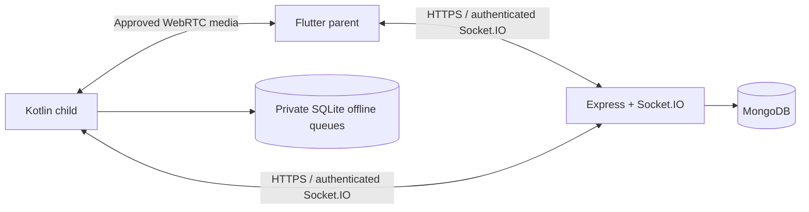
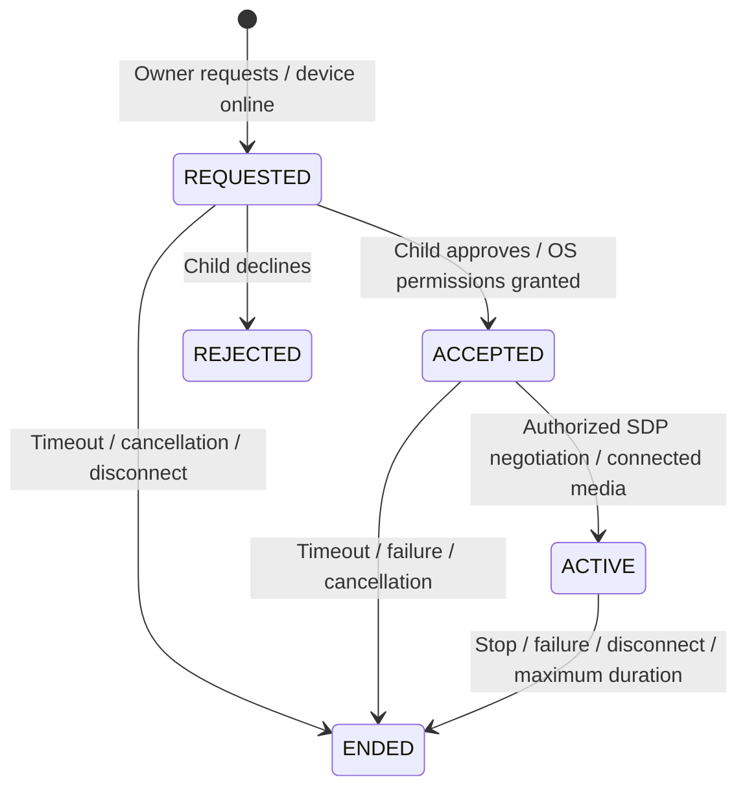

# Architecture and current contracts

The parent client has 13 screens: login, registration, child creation, family dashboard, location, geofence list/editor, app policies, web rules, browsing history, usage reports, screen sharing and camera streaming. The dashboard separates family and recorded activity, retains per-child actions and exposes synchronization/unknown states.

## Accounts and authorization

User roles are PARENT and CHILD. A child belongs to exactly one parent through `User.parentId`. REST authentication verifies JWT signature/algorithm, validated subject/role, the live user and token version. Logout/password changes increment the token version and disconnect that user's sockets. Legacy tokens without a version are accepted only while the stored version is zero; revoked versions fail closed.

All parent reads/controls verify the target child's current ownership. Child uploads are bound to the authenticated child's own ID. App inventory and usage uploads require CHILD role. Child account/device tokens currently identify a primary child account rather than a separately enrolled physical device; multiple physical devices must use separate child accounts until device-scoped enrollment is implemented.

The shared service token is server-to-server only. `/api/child/lookup` now requires that service token and returns only validation plus an ID/login identifier. It no longer exposes child names or premium details publicly. Checkout must proxy this lookup through its authenticated/trusted server; never embed the service token in a browser. Premium changes require both the URL child ID and body identifier to match. This is administrative synchronization, not proof that a merchant transaction was verified.

## REST inventory

- `/api/auth`: parent register/login, child login, refresh and logout. Website-compatible `/api/parent/login` and `/api/child/login` share abuse limiting and validation.
- `/api/children`: parent-owned create/list/detail and child-only app inventory sync; app policy/category updates, device pause and the child's cached-policy download.
- `/api/devices/register`: authenticated child registration preserving its primary record/pause state across display-name changes.
- `/api/children/:childId/web-rules`: parent-owned CRUD; `/my-web-rules` downloads only the child's own rules.
- `/api/children/:childId/browsing-history`: parent-owned search/pagination, analytics and clear; child-only `/batch` ingestion.
- `/api/children/:childId/geofences`: parent-owned CRUD/toggle plus recorded alert/read APIs and child-only `/my-geofences`.
- `/api/children/:childId/usage`: child-only daily sync, authorized report reads and owner-only request-sync.
- `/api/location`: child-only record/batch; parent-owned latest/history. Fix timestamps, not presence, establish location freshness.
- `/api/screen-share` and `/api/camera-stream`: owner-only request, participant-only session read/stop.
- `/api/config`: authenticated ICE configuration, `mediaProtocolVersion: 2` and `consentRequired: true`. The parent refuses to request media through a legacy backend. No default public TURN fallback is added by clients.
- `/api/children/:childId/history`: explicit scoped deletion; `/export` provides bounded cursor-based export.
- `/api/account`: authenticated email/password changes. Full account deletion is not yet implemented.
- `/api/admin/parent-child` and `/api/child/:id/premium`: service-token-only website/admin integration.
- `/health`: process liveness. `/ready`: database readiness and nonsecret `RELEASE_REVISION`.

Validation failures return 422, unauthorized authentication 401, ownership failures 403, absent records 404 and expired/conflicting operations 409. Socket operations return an acknowledgement `{ok, code?}` and emit `operation_error` with the event name and a non-sensitive code. Database failures never log request bodies, database URIs or user records.

## Socket events

Authentication is checked at handshake and before each mutation/relay. Token expiry disconnects the socket. Each connection has a bounded event budget, and Engine.IO caps signaling payloads at 100 KB.

- `child_heartbeat`, `location_update`, `new_browsing_activity`, `usage_updated`: CHILD only, identity derived from the token. Presence, location, history, alerts and usage updates go only to the owning parent. Usage forwarding reads the persisted report instead of trusting the supplied report body.
- `instant_lockdown_toggle`, `unblock_response`, `request_usage_sync`: require parent ownership before writes or forwarding. Temporary requests are bound to child, parent, package and request ID, expire after ten minutes and resolve once.
- `join_session`: participant identity, ownership, open/unexpired state and consent-capable client are checked before room entry.
- `screen_share_accept/reject`, `camera_stream_accept/reject`: the child participant may resolve only a current REQUESTED session. Acceptance alone is not a connected stream.
- `webrtc_offer`: only the child participant, after consent, once per negotiation. `webrtc_answer`: only the parent participant, after an offer, once. `ice_candidate`: only a current session participant after acceptance.
- `media_connected`: child participant only, after offer/answer; changes ACCEPTED to ACTIVE. Parent UI separately requires a video track and an actually connected peer transport.
- Camera switching requires the parent participant and an ACTIVE session. The displayed lens label describes the requested lens; hardware switch confirmation is a remaining enhancement.
- Stop events authorize participants, end sessions, release reservations and notify participant sockets directly as well as session rooms. Last-participant disconnect and expiry do the same.

A primary child device must register `mediaConsentVersion: 2` before new media requests are allowed. Version-1 clients retain other features but cannot initiate the retired automatic media path. One screen and one camera request may exist per child at a time, enforced atomically by a lease document's intrinsic MongoDB `_id` uniqueness.

## Media lifecycle

Pending negotiation expires in two minutes. Active sessions expire after 30 minutes and also end when authenticated participants disconnect. Each new session requests fresh permission. Screen capture grants are never cached or reused; camera/microphone services start only from the visible approval activity. Foreground notices and child controls stop the actual media services. The parent closes resources when stopped or leaving the viewer. Media-service sockets do not overwrite monitoring-service callbacks.

## Accuracy and reliability

- Foreground app use is calculated from clipped Android usage-event intervals, including unmatched active intervals and hour/day boundaries. It is labeled as app usage, not measured display-on time.
- Screen-off is independently derived from screen-state events and stays unavailable if initial state is unknown. Scheduled downtime and pause duration are not inferred from elapsed time.
- Device IANA time zones determine report days, geofence schedules and browsing analytics. Overnight restrictions belong to their starting day; end boundaries are exclusive. DST-aware day boundaries are tested.
- Location and browsing upload paths share validation/deduplication. Old offline fixes cannot replace newer fixes or generate live crossings. A single-process ingestion queue avoids socket/REST duplicates; distributed ingestion requires a shared queue and reviewed unique-index migration.
- Child SQLite upgrades are additive. Offline fixes/history and existing policy data survive updates; temporary grants use wall/monotonic expiry plus a boot binding. Location queues are bounded.
- Restrictive app policies are rechecked every ten seconds while the same foreground app remains open; a new app-window event is not required for a limit or schedule boundary. Missing usage access does not invent a usage value or default limit. Critical system/default dialer and launcher apps remain exempt.
- App inventory refreshes on a package fingerprint change or after six hours. Small validated PNG thumbnails are uploaded in batches; missing icons use a consistent fallback. Usage scans do not repeatedly render every installed icon.

Scaling, device-scoped enrollment, background-location recovery across all OEMs, hardware media compatibility and real-device accuracy remain separate release gates.
